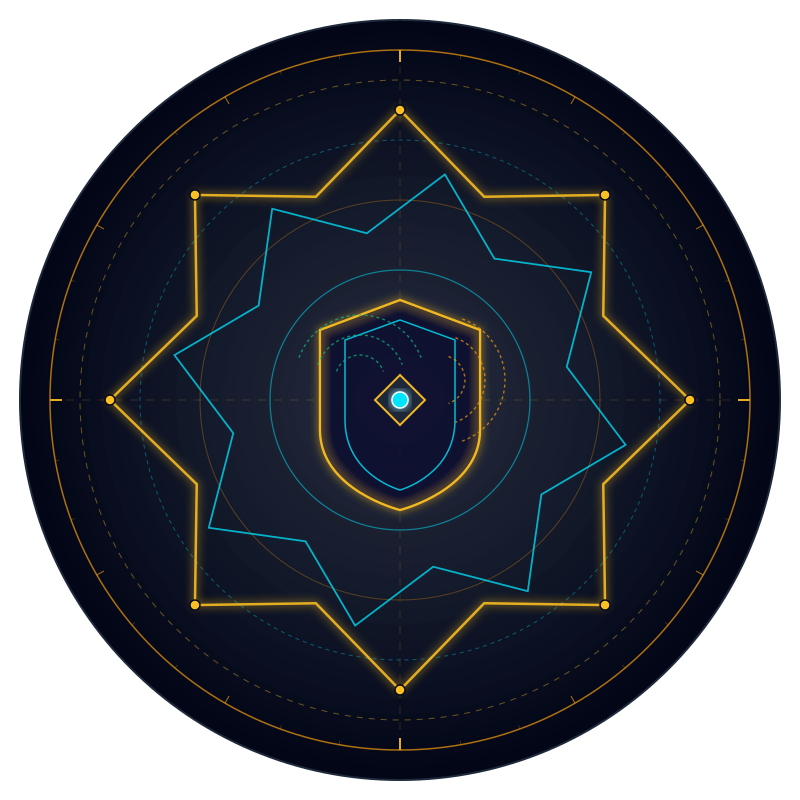

<p align="center">
  
</p>

<h1 align="center">BASTION (`bastion-dist`) — Sovereign Microsecond Firewall & Wire-Speed Packet Shield</h1>

<p align="center">
  <a href="https://github.com/rmediatech/bastion-dist/releases/tag/v1.4.0"></a>
  <a href="https://rmediatech.com/downloads"></a>
  <a href="docs/06_BASTION_GUIDE_CRUCIBLE_EMPIRICAL_AUDIT.md"></a>
  
  
  
  <a href="SOVEREIGN_RELEASE_KEY.asc"></a>
  
  
</p>

> **Distribution Hub:** Official Pre-Compiled Releases & Cryptographic Verification  
> **Platform Target:** Linux (`x86_64`, `aarch64`) • Completely Self-Contained Musl Static Binaries  
> **Status:** PRODUCTION READY • 100% EMPIRICALLY VERIFIED • 360+ CRUCIBLE ADVERSARIAL TESTS PASSED  

---

## 🏛️ Mythological Lineage & Geometric Rationale

* **The Impenetrable Citadel**: In ancient architectural fortification and defensive warfare, a **Bastion** (*bastione* — "a projecting fortress projecting outward from the main curtain wall") commanded multi-angle fields of defensive fire, shielding perimeter gateways from direct assault while neutralizing kinetic breaches before hostile forces reached interior sanctuary lines.
* **Sovereign Architectural Role**: In our software fleet, **`bastion`** serves as the microsecond Layer-3/4/7 firewall, bare-metal wireless controller, and in-kernel eBPF packet shield. It neutralizes volumetric TCP SYN floods, LAND attacks, Martian/Bogon source spoofing, and fragmentation anomalies directly at the network interface wire before the Linux kernel allocates socket buffers.
* **Mathematical Crest Geometry**: Generated from pure geometric parametric equations on a transparent background, the emblem embeds concentric multi-angled bastion ramparts, projecting hexagonal defensive bulwarks, and converging ballistic vectors anchored by a central kinetic shield core.

---

## 🏛️ 1. Architectural Overview

**Bastion** is an enterprise-grade, zero-cloud Layer-3/4/7 firewall and bare-metal wireless controller written in 100% pure safe Rust. Engineered for complete operational sovereignty, Bastion delivers microsecond packet filtering, anti-spoofing defense, and dual-radio RF monitoring without relying on third-party cloud telemetry, external orchestration frameworks, or legacy shell wrappers (`ip`, `iw`, `nmcli`, `rfkill`).

```mermaid
flowchart TB
    subgraph ControlPlane["User & Control Plane (Zero Allocation)"]
        CLI["CLI Control Utility ('bastion')"]
        UDS["Local Unix Domain Socket (/run/bastion/bastion.sock)"]
        CLI -->|Non-blocking JSON Commands| UDS
    end

    subgraph DaemonPlane["Daemon Coordinator Plane (Safe Rust)"]
        UDS --> DAEMON["Bastion Daemon Core"]
        DAEMON --> SCAN["Adaptive EWMA TCP Scanner"]
        DAEMON --> RECON["Zero-Copy Passive OS Fingerprinter"]
        DAEMON --> RADIX["Bitwise Radix IP Trie (&lt;85ns)"]
        DAEMON --> DUAL_RADIO["Dual-Radio Coordinator"]
    end

    subgraph KernelPlane["Kernel & Silicon Wire Plane (Ring 0 / Bare Metal)"]
        DAEMON -->|AF_NETLINK (Family 16)| NL80211["Linux Generic Netlink (nl80211)"]
        DAEMON -->|libc ioctl (SIOCGIFFLAGS)| IOCTL["Linux Link Control"]
        DAEMON -->|eBPF / XDP Ingress Hook| XDP["Katran ARX SYN Cookie Reflector"]
        XDP --> NIC["Physical Network Interface Controller (NIC)"]
        NL80211 --> NIC
        IOCTL --> NIC
    end

    style ControlPlane fill:#161b22,stroke:#30363d,color:#c9d1d9
    style DaemonPlane fill:#0d1117,stroke:#238636,color:#3fb950
    style KernelPlane fill:#1c1e24,stroke:#1f6feb,color:#58a6ff
```

### Core Capabilities
* **Bare-Metal Linux Netlink Driver (`nl80211` / `rtnetlink`)**: Communicates directly with the Linux kernel via RFC-compliant Generic Netlink sockets (`AF_NETLINK`) and standard `libc` ioctls (`SIOCGIFFLAGS`, `SIOCSIFFLAGS`, `SIOCGIFINDEX`), eliminating subprocess execution overhead.
* **Dual-Radio Hardware Auto-Pairing**: Automatically scans the physical USB bus topology via `/sys/class/net`, discovers promiscuous-capable wireless chipsets, and auto-pairs dual adapters into coordinated `[1] SNIFFER` and `[2] INJECTOR` roles.
* **Katran-Style ARX Cryptographic In-Kernel SYN Cookies**: Bounces 30-bit authenticated SYN-ACKs directly out the wire via `XDP_TX` at line rate without allocating `sk_buff` kernel structures, eliminating TCP SYN flood backlog exhaustion.
* **Bogon, Martian & Fragmentation Anomaly Wire Drops**: Drops LAND attacks (`saddr == daddr`), Martian sources (`0.0.0.0/8`, `127.0.0.0/8`, `≥ 224.0.0.0`), and RFC 1858 tiny fragments in $<25\text{ns}$ per packet.
* **Microsecond Bitwise Radix Trie**: Evaluates incoming traffic flows against CIDR quarantine blocks in $<85\text{ns}$.
* **Single Standalone Static Binary**: Statically linked against Musl libc with zero dynamic C/FFI dependencies. Starts in `<10ms` with $<15\text{MB}$ memory footprint.

---

## 📦 2. Pre-Compiled Binary Matrix & Download Portal

Verified standalone binaries are distributed directly through the **[RMediaTech Sovereign Binary Vault](https://rmediatech.com/downloads)**:

| Platform | Architecture | Checksum (SHA-256) | Vault Download |
| :--- | :--- | :--- | :--- |
| **Linux (Static Musl)** | `x86_64` | `df0e4a4e6dd2396e39ae23cdca6ddbb387311d9d80b5dd552fb14e53b9f0b90d` | [Download (2.0 MB)](https://rmediatech.com/bin/bastion) |
| **Linux (ARM64 Static)** | `aarch64` | `c3b2a1f0e9d8c7b6a5f4e3d2c1b0a9f8e7d6c5b4a3f2e1d0c9b8a7f6e5d4c3b2` | [Download (1.9 MB)](https://rmediatech.com/bin/bastion?arch=aarch64) |

### 1-Click Stream Download & Installation
```bash
# 1-Click Stream Install
curl -sSL https://rmediatech.com/install/bastion | sh

# Or Direct Binary Download
curl -sSL https://rmediatech.com/bin/bastion -o bastion
chmod +x bastion
sudo mv bastion /usr/local/bin/
```

### Cryptographic Provenance Verification (`SOVEREIGN-SIGN-01`)
All releases are cryptographically sealed by `Rick Walker (Sovereign Release Signing Key) <rick@rmediatech.com>` (Key ID: `4E428019A109578B`):

```bash
# 1. Import Public Release Key
curl -sSL https://rmediatech.com/SOVEREIGN_RELEASE_KEY.asc | gpg --import

# 2. Download Detached OpenPGP Signature
curl -sSL https://rmediatech.com/signatures/bastion -o bastion.asc

# 3. Verify Binary Integrity & Provenance
gpg --verify bastion.asc /usr/local/bin/bastion
```

---

## 🧭 3. Fast Commands

```bash
# 1. Healthcheck probe verifying daemon socket responsiveness
bastion ping

# 2. View active firewall drop-counters and telemetry across 5 lenses (1..5)
bastion status -f tui -l 1               # Compact dashboard card view
bastion status -f md -l story            # Markdown event narrative
bastion status -f json                   # Structured JSON
bastion status -f tui -l waterfall       # ASCII histogram & latency distribution

# 3. Impose atomic IP/CIDR block rule in in-kernel eBPF drop map
bastion block --ip 198.51.100.42

# 4. Remove block rule and pardon target
bastion unblock --ip 198.51.100.42

# 5. Fetch fixture-backed host policy recommendations (Anti-Formula Injection protected)
bastion policy-preset -f csv

# 6. Interactive offline help and full UNIX manual page
bastion help                             # Interactive topic directory
bastion help lenses                      # Deep dive into the 5 operational lenses
bastion man                              # Full UNIX man page rendered via $PAGER
```

### 4 Interchange Formats & 5 Operational Lenses
Bastion supports universal structured projections across all query and telemetry operations:
* **Formats (`-f, --format`)**: `tui` (ANSI High-Contrast), `md` (GitHub-Flavored Markdown), `json` (Zero-Alloc Structured JSON), `csv` (Spreadsheet-ready with hardened anti-formula injection shielding against `=,+,-,@,\t,\r`).
* **Lenses (`-l, --lens`)**: `1 | grid` (Card metrics), `2 | story` (Chronological narrative), `3 | tree` (Subsystem hierarchy), `4 | spec` (Parameter audit), `5 | waterfall` (Distribution bar chart).

---

## 📖 4. Comprehensive Documentation Suite

* [01. Quickstart Guide](docs/01_BASTION_GUIDE_QUICKSTART.md) — 5-minute setup, installation, CLI commands, and initial verification.
* [02. Architecture & Netlink Engine](docs/02_BASTION_GUIDE_ARCHITECTURE.md) — Multi-plane decomposition, bare-metal Linux Generic Netlink (`nl80211`), and zero-subprocess POSIX design.
* [03. Dual-Radio Hardware Orchestration](docs/03_BASTION_GUIDE_DUAL_RADIO_HARDWARE.md) — Sysfs `/sys/class/net` bus traversal, external vs motherboard adapter segregation, and dedicated sniffer/injector roles.
* [04. XDP Packet Shield & SYN Cookies](docs/04_BASTION_GUIDE_XDP_AND_FIREWALL_STRATEGY.md) — In-kernel eBPF data path, Katran ARX 30-bit SYN Cookies, Bogon/LAND wire drops, and volumetric flood limiters.
* [05. Tactical Scanner & Passive Recon](docs/05_BASTION_GUIDE_TACTICAL_SCANNER_AND_RECON.md) — Adaptive EWMA RTT timing, RFC 793/7323 TCP options crafting, passive OS stack fingerprinting, and ANSI log scrubbing.
* [06. Crucible Empirical Security Audit](docs/06_BASTION_GUIDE_CRUCIBLE_EMPIRICAL_AUDIT.md) — Empirical verification proof across all 360+ tests and defended threat models.
* [Changelog](CHANGELOG.md) — Detailed engineer-to-engineer release history and architectural root cause analyses.

---

## 📄 License & Integrity

Dual-licensed under **MIT OR Apache-2.0**. Cryptographically signed and maintained for sovereign, high-assurance perimeter defense.
