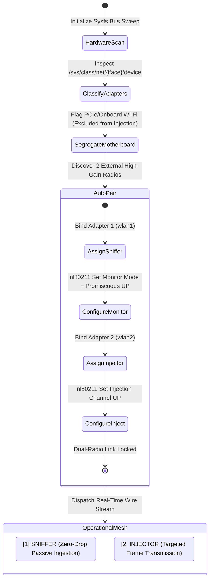

# 📡 03_BASTION_GUIDE_DUAL_RADIO_HARDWARE

> **Target Audience:** RF Engineers, Systems Administrators, Tactical Wireless Operators  
> **Topic:** Sysfs Bus Traversal, Automatic Radio Pairing, and Dedicated Dual-Radio Coordination  
> **Standard:** `SOVEREIGN-CHANGELOG-E2E-01` & `SOVEREIGN-RFC-BAREMETAL-01`  

---

## 🔍 1. Hardware Auto-Discovery via Linux Sysfs (`/sys/class/net`)

Modern tactical network assessment often requires multiple wireless network interface controllers (NICs). In manual workflows, operators frequently target the wrong adapter or disrupt primary internet connectivity on internal motherboard Wi-Fi.

Bastion resolves this through `SysfsDiscovery`:
1. Traverses `/sys/class/net/` without invoking external commands.
2. Follows interface symbolic links into physical device bus descriptors (e.g., `/sys/devices/pci.../usb.../`).
3. Reads `idVendor` and `idProduct` registers from parent USB controller nodes.
4. Identifies promiscuous-capable chipsets (Atheros AR9271, MediaTek MT7921/MT7612U, Realtek RTL8812AU).
5. Segregates internal motherboard wireless NICs (PCIe) from dedicated external USB antennas.

---

## 👥 2. Coordinated Dual-Radio Auto-Pairing State Machine

When two compatible external adapters are connected, Bastion automatically binds them into specialized roles:

---

## 🛡️ 3. Role Specialization

### Role 1: Dedicated Sniffer (`[1] SNIFFER`)
* Placed into 802.11 Monitor Mode via Generic Netlink.
* Executes continuous zero-drop packet capture across 2.4 GHz and 5 GHz frequency bands.
* Ingests raw radio frames (`Radiotap`, IEEE 802.11 MAC headers, Information Elements).
* Never transmits packets, ensuring receiver sensitivity and channel hopping are never interrupted.

### Role 2: Dedicated Injector (`[2] INJECTOR`)
* Bound to the exact frequency channel of the active engagement target.
* Executes zero-delay targeted frame transmission.
* Isolates RF transmission power surges from the sensitive listening receiver.

---

## 🔬 4. Empirical Verification

Bastion's dual-radio discovery engine is empirically verified in live integration tests:
* `test_live_sysfs_auto_pair_dual_adapters`: Asserts correct role assignment, bus ID resolution, and onboard adapter isolation.
* Prevents accidental disruption of host workstation internet connectivity.
